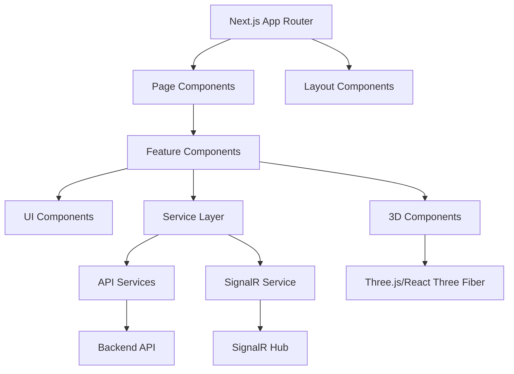
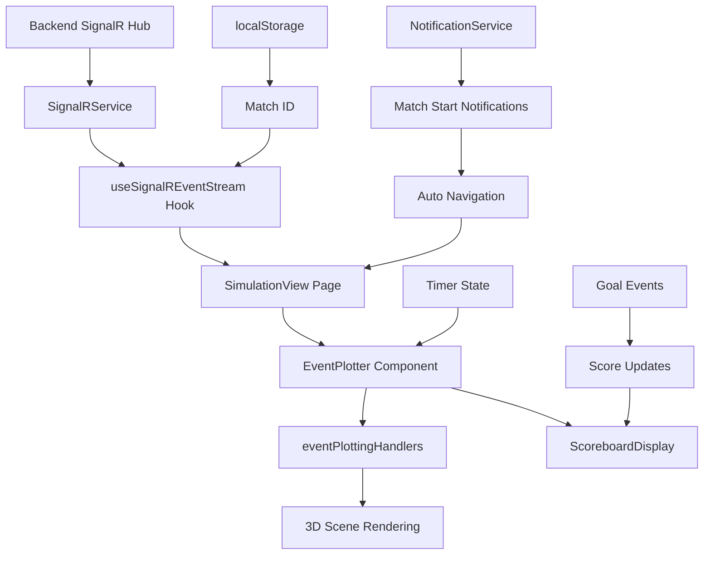

# PixelPitch Frontend Documentation

## Table of Contents

1. [Project Overview](#project-overview)
2. [Technology Stack](#technology-stack)
3. [Project Structure](#project-structure)
4. [Architecture](#architecture)
5. [Core Components](#core-components)
6. [3D Visualization System](#3d-visualization-system)
7. [Event System & Real-time Processing](#event-system--real-time-processing)
8. [Simulation View Implementation](#simulation-view-implementation)
9. [Services & API Integration](#services--api-integration)
10. [Real-time Communication](#real-time-communication)
11. [Notification System](#notification-system)
12. [Authentication & Security](#authentication--security)
13. [UI Components](#ui-components)
14. [Styling & Design System](#styling--design-system)
15. [State Management](#state-management)
16. [Performance Optimizations](#performance-optimizations)
17. [Development Guidelines](#development-guidelines)
18. [Deployment & Build Process](#deployment--build-process)
19. [Testing & Debugging](#testing--debugging)

---

## Project Overview

**PixelPitch** is a modern football match visualization and simulation platform built with Next.js, featuring real-time 3D match visualization, comprehensive match data analysis, and interactive user experiences. The frontend provides an immersive 3D football pitch where users can visualize live match events, replay simulations, and interact with detailed match statistics.

### Key Features

- **3D Match Visualization**: Real-time 3D rendering of football matches using Three.js and React Three Fiber
- **Live Event Streaming**: Real-time match events via SignalR integration
- **Interactive Dashboard**: Comprehensive admin and user dashboards
- **Match Simulation**: Replay and analyze historical matches
- **Responsive Design**: Modern, mobile-first responsive design
- **Authentication System**: Secure user authentication and authorization
- **Real-time Updates**: Live match data and notifications

---

## Technology Stack

### Core Technologies

```json
{
  "framework": "Next.js 15.3.2",
  "language": "TypeScript",
  "runtime": "React 19.0.0",
  "package_manager": "pnpm"
}
```

### 3D Graphics & Visualization

```json
{
  "three_js": "0.176.0",
  "react_three_fiber": "9.1.2",
  "react_three_drei": "10.0.7"
}
```

### UI & Styling

```json
{
  "tailwind_css": "Latest",
  "daisyui": "5.0.35",
  "framer_motion": "12.12.1",
  "radix_ui": "Multiple components",
  "lucide_react": "0.509.0",
  "heroicons": "2.2.0"
}
```

### Communication & API

```json
{
  "axios": "1.9.0",
  "signalr": "@microsoft/signalr 8.0.7",
  "jwt_decode": "4.0.0"
}
```

### Development Tools

```json
{
  "eslint": "Latest",
  "prettier": "3.5.3",
  "typescript": "Latest"
}
```

---

## Project Structure

```
PixelPitch-Frontend/
├── app/                          # Next.js App Router
│   ├── Components/               # Reusable UI components
│   │   ├── AdminDashboard/       # Admin-specific components
│   │   ├── DashboardContent/     # Dashboard content components
│   │   ├── FootballPitch/        # 3D pitch components
│   │   ├── Hero Section/         # Landing page hero
│   │   ├── LatestMatches/        # Match listing components
│   │   ├── Logo3d/               # 3D logo component
│   │   ├── MatchStats/           # Statistics components
│   │   ├── Navbar/               # Navigation components
│   │   ├── NotificationSettings/ # Notification management
│   │   ├── ProfileCard/          # User profile components
│   │   ├── ProtectedRoute/       # Route protection
│   │   ├── RightPanel/           # Sidebar panels
│   │   ├── Sidebar/              # Navigation sidebar
│   │   ├── SignIn/               # Authentication components
│   │   └── SpaceEfficiencyPanel/ # UI optimization
│   ├── admin/                    # Admin dashboard pages
│   ├── dashboard/                # User dashboard pages
│   ├── home/                     # Home page
│   ├── login/                    # Authentication pages
│   ├── matchdetails/             # Match detail pages
│   ├── matchsimulation/          # Match simulation interface
│   ├── profile/                  # User profile pages
│   ├── register/                 # User registration
│   ├── simulationview/           # Simulation viewer
│   └── trial/                    # Testing/trial pages
├── components/                   # 3D visualization components
│   ├── plotters/                 # Event plotting handlers
│   │   └── eventPlottingHandlers.tsx
│   ├── ui/                       # Reusable UI components
│   ├── CurvedArrow.tsx           # 3D curved arrow visualization
│   ├── EventPlotter.tsx         # Main event plotting system
│   ├── Field.js                 # 3D football field
│   ├── Flag.js                  # 3D flag objects
│   ├── Goal.js                  # 3D goal posts
│   ├── PlayerMarker.tsx         # 3D player markers
│   └── StraightArrow.tsx        # 3D straight arrow visualization
├── hooks/                        # Custom React hooks
│   ├── useMockEventStream.ts     # Mock event streaming
│   └── useSignalREventStream.ts  # Real-time event streaming
├── lib/                          # Utility libraries
│   ├── fieldConfig.js            # Field configuration
│   └── utils.ts                  # General utilities
├── Services/                     # API service layer
│   ├── ApiService.ts             # Core API service
│   ├── AuthenticationService.ts  # Authentication logic
│   ├── CoachService.ts           # Coach management
│   ├── MatchService.ts           # Match operations
│   ├── MatchSimulationService.ts # Simulation logic
│   ├── NotificationService.ts    # Notification handling
│   ├── PlayerService.ts          # Player management
│   ├── SearchService.ts          # Search functionality
│   ├── SeasonService.ts          # Season management
│   ├── SignalRService.ts         # Real-time communication
│   ├── StadiumService.ts         # Stadium management
│   └── TeamService.ts            # Team management
├── types/                        # TypeScript type definitions
│   └── Event.ts                  # Event type definitions
├── public/                       # Static assets
│   ├── assets/                   # General assets
│   ├── data/                     # Static data files
│   ├── images/                   # Image assets
│   ├── logos/                    # Logo files
│   └── models/                   # 3D model files
└── Docs/                         # Project documentation
```

---

## Architecture

### Application Architecture

The PixelPitch frontend follows a modern, component-based architecture with clear separation of concerns:



### Layer Breakdown

1. **Presentation Layer**: Next.js pages and React components
2. **Business Logic Layer**: Custom hooks and service classes
3. **Data Layer**: API services and real-time communication
4. **3D Visualization Layer**: Three.js components and event handlers
5. **State Management**: React state with custom hooks

---

## Core Components

### 1. 3D Visualization Components

#### EventPlotter.tsx - Main Event Orchestrator

The central component responsible for rendering all match events in 3D space.

**Key Features:**

```typescript
interface EventPlotterProps {
  events: Event[];
  timer: number;
}

// Core functionality:
- Event filtering and processing (last 5 events)
- Real-time scoreboard updates
- Team identification and color coding
- Goalkeeper name normalization
- Ball position management
- Sent-off player tracking
```

**Event Processing Pipeline:**

1. **Team Extraction**: Identifies home/away teams from match_start event
2. **Goalkeeper Normalization**: Cleans goalkeeper names for display
3. **Event Filtering**: Processes only relevant event types
4. **Player Tracking**: Tracks sent-off players to hide their events
5. **3D Rendering**: Converts events to 3D visualizations
6. **Score Management**: Real-time score updates from goal events

#### eventPlottingHandlers.tsx - Event Rendering Engine

Contains specialized rendering functions for each event type:

**Event Renderers:**

```typescript
// Match Flow Events
renderMatchStartEvent(); // Fireworks and "Match Started" animation
renderMatchEndEvent(); // End game celebrations

// Player Movement Events
renderPassEvent(); // Pass visualization with arrows
renderBallReceiptEvent(); // Ball reception markers
renderCarryEvent(); // Player carrying ball
renderPressureEvent(); // Defensive pressure indicators

// Ball Actions
renderShotEvent(); // Shot trajectories and goal animations
renderSaveEvent(); // Goalkeeper saves with text
renderThrowInPassEvent(); // Throw-in trajectories

// Referee Decisions
renderFoulEvent(); // Foul markers with penalty notifications
renderCardEvent(); // Yellow/Red card displays

// Special Components
GoalAnimation(); // Epic goal celebration effects
MatchStartAnimation(); // Match start with fireworks
ScoreboardDisplay(); // 3D scoreboard with live updates
```

**Position Mirroring System:**

```typescript
function getMirroredPosition(
  pos: [number, number],
  team: string,
  homeTeam?: string,
  awayTeam?: string
): [number, number] {
  // Mirrors away team positions for consistent perspective
  // Field center: [60, 40], Size: 120m x 80m
  // 3D coordinate conversion: [x - 60, y, z - 40]
}
```

### 2. Advanced Animation Components

#### GoalAnimation Component

**Epic multi-phase goal celebration:**

```typescript
// Animation Phases:
Phase 1: Ball trajectory with Bezier curves
Phase 2: Explosion effects with particles
Phase 3: Text celebrations and fade out

// Visual Effects:
- Realistic ball spin and trail
- 24+ explosion particles with colors
- Dynamic lighting system
- Spotlights following ball
- Emissive materials and glows
```

#### MatchStartAnimation Component

**Match opening ceremony:**

```typescript
// Features:
- Elastic text scaling animation
- 24 firework particles
- Explosion patterns in 3D space
- Color cycling effects
- Timed sequence coordination
```

### 3. 3D Scene Elements

#### Field Components

```typescript
Field.js; // Football pitch with proper markings
Goal.js; // 3D goal posts and nets
Flag.js; // Corner flags and markers
PlayerMarker.tsx; // Player position indicators
```

#### Ball System

```typescript
// 3D Soccer Ball Model:
- GLTF model loading (/models/soccer_ball.glb)
- Dynamic positioning system
- Real-time movement coordination
- Scale and animation effects
```

#### Arrow Components

```typescript
StraightArrow.tsx  // Direct pass/shot trajectories
CurvedArrow.tsx    // High balls and curved passes
// Both support:
- Start/end position calculation
- Height-based trajectory rendering
- Team color coordination
- Animation timing
```

### 2. Navigation & Layout Components

#### Sidebar Components

- **Sidebar.tsx**: Main navigation sidebar
- **SidebarItem.tsx**: Individual navigation items
- **SidebarSection.tsx**: Grouped navigation sections

#### Navbar Components

- **Navbar.tsx**: Main navigation bar
- **SigninNavbar.tsx**: Authentication-specific navigation

### 3. Dashboard Components

#### AdminDashboard

Administrative interface components for managing:

- Teams and players
- Matches and seasons
- User management
- System settings

#### DashboardContent

User dashboard components displaying:

- Personal statistics
- Recent matches
- Notifications
- Quick actions

### 4. Complete Component Architecture

#### App Router Structure (Next.js 15)

```typescript
app/
├── layout.tsx                    // Root layout with global providers
├── page.tsx                      // Landing page
├── globals.css                   // Global styles and Tailwind
├── admin/page.tsx                // Admin dashboard interface
├── dashboard/page.tsx            // User dashboard
├── home/page.tsx                 // Home page content
├── login/page.tsx                // Authentication interface
├── matchdetails/page.tsx         // Match analysis page
├── matchsimulation/page.tsx      // Simulation control interface
├── profile/page.tsx              // User profile management
├── register/page.tsx             // User registration
├── simulationview/[id]/page.tsx  // Real-time 3D visualization
└── trial/page.tsx                // Testing/demo interface
```

#### Feature Component Library (/app/Components/)

```typescript
// Dashboard & Admin
AdminDashboard/           // Administrative interface components
├── [Multiple admin components for system management]

DashboardContent/         // User dashboard elements
├── [User-specific dashboard widgets and panels]

// 3D Visualization
FootballPitch/           // 3D pitch rendering components
ModelViewer.tsx          // Generic 3D model display component

// Navigation & Layout
Navbar/                  // Navigation bar components
├── Navbar.tsx          // Main navigation
└── SigninNavbar.tsx    // Authentication-specific navigation

Sidebar/                 // Sidebar navigation system
├── Sidebar.tsx         // Main sidebar container
├── SidebarItem.tsx     // Individual navigation items
└── SidebarSection.tsx  // Grouped navigation sections

// User Interface
Hero Section/           // Landing page hero components
LatestMatches/         // Match listing and display
├── LatestMatches.tsx  // Container component
└── MatchCard.tsx      // Individual match cards

Logo3d/                // 3D logo components
MatchStats/            // Statistical display components
NotificationSettings/  // Notification preference management
ProfileCard/           // User profile display
RightPanel/           // Right sidebar panels
├── RightPanel.tsx    // Main panel container
├── LiveMatchPanel.tsx // Live match information
└── TeamsList.tsx     // Team listing component

// Utility & Security
ProtectedRoute/        // Route authentication wrapper
SignIn/               // Authentication forms
SpaceEfficiencyPanel/ // UI optimization tools
```

#### Core 3D Components (/components/)

```typescript
// Main 3D System
EventPlotter.tsx          // Central event orchestrator
plotters/
└── eventPlottingHandlers.tsx // Event-specific rendering functions

// 3D Visualization Elements
CurvedArrow.tsx          // Curved trajectory visualization
StraightArrow.tsx        // Linear trajectory visualization
PlayerMarker.tsx         // Player position indicators
Field.js                 // Football pitch geometry
Goal.js                  // Goal post 3D models
Flag.js                  // Field markers and flags

// UI Component Library
ui/                      // Reusable UI components
├── button.tsx           // Button variants
├── input.tsx            // Form inputs
├── textarea.tsx         // Multi-line inputs
├── select.tsx           // Dropdown selections
├── tabs.tsx             // Tabbed interfaces
├── switch.tsx           // Toggle switches
├── label.tsx            // Form labels
├── alert.tsx            // Alert notifications
└── pagination.tsx       // Data pagination
```

#### Service Layer Architecture (/Services/)

```typescript
// Core Services
ApiService.ts; // Central HTTP client with interceptors
AuthenticationService.ts; // User authentication & JWT management
SignalRService.ts; // Real-time communication hub

// Domain Services
MatchService.ts; // Match data operations
MatchSimulationService.ts; // Simulation control and management
TeamService.ts; // Team management operations
PlayerService.ts; // Player data operations
CoachService.ts; // Coach management
StadiumService.ts; // Stadium information
SeasonService.ts; // Season management

// Utility Services
NotificationService.ts; // Notification system with type handling
SearchService.ts; // Search functionality across entities
```

#### Custom Hooks (/hooks/)

```typescript
// Real-time Data Hooks
useSignalREventStream.ts  // Production event streaming
useMockEventStream.ts     // Development/testing event simulation

// Hook Capabilities:
- Automatic connection management
- Event buffering and processing
- Connection state monitoring
- Retry logic with exponential backoff
- Error handling and recovery
```

#### Type System (/types/)

```typescript
Event.ts; // Comprehensive event type definitions
// Includes 22 event types, position data, outcome states
// Full TypeScript coverage for all match events
```

#### Static Assets (/public/)

```typescript
assets/           // General application assets
data/            // Static data files for development
images/          // UI images and graphics
logos/           // Team and application logos
models/          // 3D model files (.glb, .gltf)
├── soccer_ball.glb    // Main ball model for 3D scenes
```

---

## 3D Visualization System

### Core Technologies

- **Three.js 0.176.0**: 3D graphics engine
- **React Three Fiber 9.1.2**: React renderer for Three.js
- **React Three Drei 10.0.7**: Utility components and helpers

### Coordinate System & Field Layout

```typescript
// Field Configuration:
Field Dimensions: 120m × 80m (real-world scale)
Field Center: [60, 40] (in field coordinates)
3D Position Mapping: [x - 60, y, z - 40]

// Team Perspective System:
Home Team: Left to right attack (blue markers)
Away Team: Right to left attack (white markers)
Position Mirroring: Automatic for away team events

// Camera Setup:
Default Position: [0, 50, 50] (elevated rear view)
Target: Field center for optimal viewing
FOV: Optimized for full field visibility
```

### Advanced Rendering Features

#### 1. Dynamic Event Visualization

```typescript
// Supported Event Types (22 total):
Match Flow: match_start, match_end, first_half_end, second_half_start
Ball Movement: pass, ball_receipt, carry, shot, save
Player Actions: pressure, duel, interception, block, dribble, ball_recovery
Set Pieces: throw_in_pass, free_kick_pass, corner_pass, goal_kick_pass
Referee Events: foul_committed, foul_won

// Real-time Processing:
- Event filtering (last 5 events displayed)
- Position mirroring for team perspective
- Sent-off player tracking and hiding
- Automatic ball position updates
```

#### 2. Sophisticated Animation System

```typescript
// Goal Animation Sequence:
Phase 1: Ball flight with Bezier curve trajectory
  - Realistic physics simulation
  - Multiple rotation axes for spin effect
  - Dynamic trail particles (8 trail elements)
  - Scale progression for depth perception

Phase 2: Goal explosion effects
  - 24 explosion particles in 3D space
  - 12 additional sparkle effects
  - Color cycling through 12 vibrant colors
  - Dynamic scaling and rotation per particle

Phase 3: Celebration display
  - "⚽ GOOOAL! ⚽" text with outline
  - Secondary "INCREDIBLE SHOT!" text
  - Dramatic multi-point lighting system
  - Automatic fade-out after 4 seconds

// Match Start Fireworks:
- 24 firework particles with color cycling
- Elastic text scaling with easing functions
- Explosion patterns in spherical coordinates
- Synchronized timing with text animation
```

#### 3. Advanced Lighting & Materials

```typescript
// Stadium Lighting System:
Primary Lights: 4 strategic point lights
Team Accent Lights: Blue (home) and white (away)
Dynamic Lighting: Ball-following spotlight system
Ambient Enhancement: Multiple decay and distance settings

// Material Properties:
Emissive Materials: Self-illuminating elements
Transparency Effects: Layered opacity for depth
Wireframe Overlays: Soccer ball pattern rendering
Metalness/Roughness: Realistic surface properties
```

#### 4. Interactive 3D Scoreboard

```typescript
// ScoreboardDisplay Features:
Layout: 75×18 unit wide display with layered backgrounds
Content: Team names, live score, formatted timer
Styling: Gradient backgrounds with team color coding
Typography: Hierarchical text sizing with outlines
Positioning: Elevated above field (y: 45, z: -30)

// Real-time Updates:
Score tracking from goal events
Timer synchronization across components
Team name extraction from match data
Color-coded team sections
```

---

## Event System & Real-time Processing

### Event Data Structure

```typescript
export type Event = {
  id: string;
  event_type: EventType;
  event_index: number;
  timestamp: number;
  team: string;
  player?: string;
  position: [number, number]; // Field coordinates
  outcome?: string; // "Goal", "Penalty", etc.
  pass_target?: [number, number]; // Pass destination
  shot_target?: [number, number]; // Shot target
  card?: 'Yellow Card' | 'Red Card' | 'Second Yellow';
  height?: 'Ground Pass' | 'High Pass';
  home_team?: string; // For match_start events
  away_team?: string; // For match_start events
};

// 22 Supported Event Types:
export type EventType =
  | 'match_start'
  | 'pass'
  | 'ball_receipt'
  | 'carry'
  | 'pressure'
  | 'duel'
  | 'interception'
  | 'block'
  | 'throw_in_pass'
  | 'foul_committed'
  | 'foul_won'
  | 'free_kick_pass'
  | 'dribble'
  | 'ball_recovery'
  | 'shot'
  | 'save'
  | 'corner_pass'
  | 'goal_kick_pass'
  | 'match_end'
  | 'first_half_end'
  | 'second_half_start';
```

### Event Processing Pipeline

#### 1. Data Normalization

```typescript
// Goalkeeper Name Processing:
getFirstGoalkeeperNames(); // Extract clean keeper names per team
normalizeGoalkeeperName(); // Remove "goal keeper" prefix

// Team Identification:
matchStartEvent.home_team; // Extract from first match_start event
matchStartEvent.away_team; // Used for all subsequent processing
```

#### 2. Event Filtering & Management

```typescript
// Event Lifecycle Management:
1. Receive events from SignalR stream
2. Normalize goalkeeper names dynamically
3. Track sent-off players (red cards/second yellows)
4. Filter out events from sent-off players
5. Apply event type allowlist
6. Limit to last 5 events for performance
7. Render in 3D space with team-specific positioning
```

#### 3. Smart Event Handling

```typescript
// Special Event Logic:
Goal Detection: Automatic score increment from shot events
Penalty Notifications: Display "PENALTY TO [TEAM]" for foul outcomes
Card Tracking: Red card/second yellow removes player from display
Ball Movement: Automatic ball positioning for relevant events
Position Mirroring: Away team events mirrored for perspective
```

---

## Simulation View Implementation

### SimulationView Page Architecture

```typescript
// Location: /app/simulationview/[simulationId]/page.tsx
// Purpose: Real-time 3D match visualization interface

Key Features:
- Dynamic match ID extraction from localStorage
- Real-time SignalR event streaming
- Synchronized timer across components
- Connection monitoring and debugging
- Automatic reconnection handling
```

### Component Integration Flow

```typescript
// Data Flow Architecture:
localStorage → matchId → useSignalREventStream → events[]
                    ↓
Timer State → EventPlotter → 3D Visualization
                    ↓
ScoreboardDisplay ← Goal Events ← Event Processing
```

### Real-time Event Streaming

```typescript
// useSignalREventStream Hook:
const { events, isConnected, retryCount } = useSignalREventStream(matchId);

// Stream Management:
- Automatic connection establishment
- Event buffering and processing
- Connection state monitoring
- Retry logic with exponential backoff
- Debug logging for troubleshooting
```

### Debugging & Monitoring System

```typescript
// Built-in Debug Functions:
testConnection()     // Test SignalR connectivity
forceReconnect()     // Manual reconnection trigger
debugSignalR()       // Comprehensive state logging

// Development Tools:
- Real-time connection status display
- Event count monitoring
- Retry attempt tracking
- Connection statistics logging
```

// Interactive features:

- 3D scoreboard with live updates
- Player markers with team identification
- Event-triggered visual effects
- Dynamic camera positioning

````

#### 4. Visual Effects
```typescript
// Advanced effects:
- Goal celebration animations
- Match start fireworks
- Ball trail effects
- Stadium lighting
- Emissive materials
````

### Coordinate System

```typescript
// Field dimensions and coordinate mapping
Field Center: [60, 40]
Field Size: 120m x 80m
3D Position Calculation: [x - 60, y, z - 40]
Team Mirroring: Automatic position adjustment for away team
```

---

## Event System

### Event Types

The system supports comprehensive football match events:

```typescript
export type EventType =
  | 'match_start'
  | 'pass'
  | 'ball_receipt'
  | 'carry'
  | 'pressure'
  | 'duel'
  | 'interception'
  | 'block'
  | 'throw_in_pass'
  | 'foul_committed'
  | 'foul_won'
  | 'free_kick_pass'
  | 'dribble'
  | 'ball_recovery'
  | 'shot'
  | 'save'
  | 'corner_pass'
  | 'goal_kick_pass'
  | 'match_end'
  | 'first_half_end'
  | 'second_half_start';
```

### Event Processing Pipeline

1. **Event Reception**: SignalR real-time event streaming
2. **Event Filtering**: Filter relevant events for visualization
3. **Position Mirroring**: Adjust positions for team perspective
4. **3D Rendering**: Convert events to 3D visualizations
5. **Animation Triggering**: Execute appropriate animations
6. **State Updates**: Update UI and scoreboard

### Event Data Structure

```typescript
export type Event = {
  id: string;
  event_type: EventType;
  timestamp: number;
  team: string;
  player?: string;
  position: Position;
  outcome?: string;
  pass_target?: Position;
  shot_target?: Position;
  card?: 'Yellow Card' | 'Red Card' | 'Second Yellow';
  height?: 'Ground Pass' | 'High Pass';
  // Additional event-specific properties
};
```

---

## Notification System

### Comprehensive Notification Architecture

The PixelPitch notification system provides real-time user notifications with advanced type handling and automatic navigation capabilities.

#### Notification Types & Backend Integration

```typescript
// Backend Notification Types (C#):
public enum NotificationType {
    MatchStart,        // Special: Auto-redirects to simulation
    MatchEnd,          // Match completion notifications
    SimulationStart,   // Similar to MatchStart
    SimulationEnd,     // Simulation completion
    MatchUpdate,       // Live match updates
    SimulationUpdate,  // Simulation progress updates
    SystemAlert,       // System-wide alerts
    UserMessage,       // Personal messages
    Info,              // General information
    Warning,           // Warning notifications
    Error,             // Error notifications
    Success,           // Success confirmations
}

// Frontend Interface:
export interface Notification {
  id: string;
  message: string;
  title?: string;
  type: NotificationType;
  isread: boolean;
  time: string;
  matchId?: number; // For match-related notifications
}
```

#### Special Match Start Handling

```typescript
// Automatic Navigation System:
MatchStart Notifications:
  - Display toast with football emoji (⚽)
  - Auto-redirect to /simulationview/{matchId}
  - Emit custom matchStartNotification events
  - Respect user auto-redirect preferences

// Implementation:
notificationService.onMatchStart((data) => {
  console.log('Match started:', data.notification);
  router.push(data.redirectTo);
});

// User Preference Control:
notificationService.setAutoRedirectPreference(true/false);
```

#### Toast Notification Styling System

```typescript
// Type-specific Styling:
MatchStart:      Blue theme with ⚽ icon
SimulationStart: Gaming theme with 🎮 icon
MatchEnd:        Gray theme with 🏁 icon
Success:         Green success toast
Error:           Red error toast
Warning:         Orange warning with ⚠️ icon
Info:            Default blue info toast
SystemAlert:     Orange system alert with ⚠️
```

#### Integration Architecture

```typescript
// Service Integration Flow:
Backend SignalR Hub → NotificationService → Type Processing → Toast Display
                                       ↓
                              Navigation Events → Router
                                       ↓
                              Component Listeners → Custom Handlers

// Component Integration Example:
useEffect(() => {
  const handleNavigation = (url: string) => router.push(url);
  notificationService.onNavigationRequest(handleNavigation);

  return () => {
    notificationService.off('requestNavigation', handleNavigation);
  };
}, [router]);
```

---

## Services & API Integration

### ApiService.ts

Central HTTP client with:

- **Request/Response Interceptors**: Automatic token attachment and error handling
- **Error Handling**: Comprehensive error categorization and retry logic
- **Performance Monitoring**: Request timing and logging
- **Type Safety**: Full TypeScript support

```typescript
// Key features:
- Automatic JWT token management
- Request retry mechanisms
- Network error detection
- Response caching capabilities
- Request/response logging
```

### Specialized Services

#### AuthenticationService.ts

- User login/logout
- Token management
- Password reset
- User registration
- Session validation

#### MatchService.ts

- Match data retrieval
- Live match status
- Match statistics
- Historical match data

#### MatchSimulationService.ts

- Simulation control
- Event replay
- Simulation settings
- Progress tracking

#### NotificationService.ts

- Real-time notifications
- User preferences
- Notification history
- Push notification support

#### SignalRService.ts

- Real-time event streaming
- Connection management
- Automatic reconnection
- Event subscription management

---

## Real-time Communication

### SignalR Integration

The application uses Microsoft SignalR for real-time communication:

```typescript
// Key capabilities:
- Live match event streaming
- Real-time notifications
- Connection state management
- Automatic reconnection
- Cross-platform support
```

### Event Streaming Hooks

#### useSignalREventStream.ts

Custom hook for real-time event streaming:

```typescript
// Features:
- Automatic connection management
- Event buffering
- Error handling
- Connection status monitoring
```

#### useMockEventStream.ts

Development hook for testing with simulated events:

```typescript
// Features:
- Realistic event simulation
- Configurable event rates
- Development testing support
```

---

## Authentication & Security

### Security Features

- **JWT Token Management**: Secure token storage and automatic renewal
- **Protected Routes**: Route-level authentication guards
- **Role-based Access**: Different access levels for users and admins
- **Secure Storage**: Proper token storage practices

### ProtectedRoute Component

```typescript
// Authentication wrapper component:
- Route protection based on authentication status
- Automatic redirects for unauthenticated users
- Role-based route access control
```

---

## UI Components

### Radix UI Integration

The application uses Radix UI primitives for consistent, accessible components:

- **Select**: Dropdown selection components
- **Switch**: Toggle switches
- **Tabs**: Tabbed interfaces
- **Label**: Form labels
- **Slot**: Component composition utilities

### Custom UI Components

Located in `components/ui/`:

- **Button**: Styled button variants
- **Input**: Form input components
- **Textarea**: Multi-line text inputs
- **Alert**: Notification and alert components
- **Pagination**: Data pagination controls

### Design System

- **Consistent Spacing**: Tailwind CSS spacing scale
- **Color Palette**: Defined color schemes for teams and UI elements
- **Typography**: Consistent font sizing and hierarchy
- **Component Variants**: Systematic component variations

---

## Styling & Design System

### Tailwind CSS Configuration

- **Utility-first Approach**: Comprehensive utility classes
- **Custom Components**: Component-specific styling
- **Responsive Design**: Mobile-first responsive breakpoints
- **Dark Mode Support**: Built-in dark theme capabilities

### DaisyUI Components

Enhanced UI components with:

- **Pre-styled Components**: Ready-to-use styled components
- **Theme System**: Multiple theme options
- **Accessibility**: Built-in accessibility features

### Animation System

- **Framer Motion**: Advanced animations and transitions
- **CSS Animations**: Performance-optimized CSS animations
- **3D Animations**: Three.js-based 3D animations
- **Micro-interactions**: Subtle UI feedback animations

---

## State Management

### React State Pattern

The application uses React's built-in state management with:

- **Local Component State**: useState for component-specific state
- **Custom Hooks**: Reusable state logic encapsulation
- **Context API**: Global state for authentication and theme
- **Effect Hooks**: Side effect management with useEffect

### State Categories

1. **Authentication State**: User login status and permissions
2. **Match State**: Current match data and events
3. **UI State**: Component visibility and interaction states
4. **3D Scene State**: Camera position and scene configuration

---

## Performance Optimizations

### React Optimizations

- **Component Memoization**: React.memo for expensive components
- **Callback Optimization**: useCallback for event handlers
- **Effect Dependencies**: Proper dependency arrays for useEffect
- **Virtual Scrolling**: Efficient rendering of large lists

### 3D Performance

- **Geometry Reuse**: Shared geometries for similar objects
- **Material Optimization**: Efficient material usage
- **LOD System**: Level-of-detail for distant objects
- **Frustum Culling**: Automatic object culling outside view

### Bundle Optimization

- **Code Splitting**: Route-based code splitting
- **Tree Shaking**: Unused code elimination
- **Asset Optimization**: Image and model compression
- **Lazy Loading**: Component lazy loading

---

## Development Guidelines

### Code Organization

```typescript
// File naming conventions:
- PascalCase for components: `PlayerMarker.tsx`
- camelCase for utilities: `fieldConfig.js`
- kebab-case for pages: `match-details`
- UPPER_CASE for constants
```

### TypeScript Best Practices

```typescript
// Type definitions:
- Strict type checking enabled
- Interface over type aliases
- Proper generics usage
- Comprehensive error types
```

### Component Guidelines

```typescript
// Component structure:
1. Imports (external libraries first)
2. Type definitions
3. Component props interface
4. Main component function
5. Default export
```

### Testing Strategy

- **Unit Testing**: Component and utility function testing
- **Integration Testing**: Service integration testing
- **E2E Testing**: Full application workflow testing
- **Visual Testing**: 3D component visual regression testing

---

## Deployment & Build Process

### Build Configuration

```json
{
  "scripts": {
    "dev": "next dev --turbopack",
    "build": "next build",
    "start": "next start",
    "lint": "next lint",
    "format": "prettier --write \"**/*.{js,jsx,ts,tsx,json,css,scss,md}\""
  }
}
```

### Deployment Pipeline

1. **Linting**: ESLint code quality checks
2. **Type Checking**: TypeScript compilation
3. **Testing**: Automated test execution
4. **Building**: Production build generation
5. **Optimization**: Asset optimization and compression

### Environment Configuration

- **Development**: Local development with hot reloading
- **Staging**: Pre-production testing environment
- **Production**: Optimized production deployment

### Performance Monitoring

- **Bundle Analysis**: Bundle size monitoring
- **Runtime Performance**: Performance metrics collection
- **Error Tracking**: Comprehensive error logging
- **User Analytics**: Usage pattern analysis

---

## Key Integration Points

### Backend API Integration

- **RESTful APIs**: Standard HTTP API communication
- **Real-time Events**: SignalR hub integration
- **Authentication**: JWT token-based authentication
- **Error Handling**: Comprehensive error handling and user feedback

### External Services

- **Asset Delivery**: CDN integration for static assets
- **Monitoring**: Application performance monitoring
- **Analytics**: User behavior tracking
- **Notifications**: Push notification services

---

## Testing & Debugging

### SimulationView Debugging System

The SimulationView page includes comprehensive debugging tools for development and troubleshooting:

#### Built-in Debug Functions

```typescript
// Connection Testing:
testConnection()     // Test SignalR connectivity and log stats
forceReconnect()     // Manual reconnection trigger
debugSignalR()       // Comprehensive state logging

// Debug Information Logged:
- Match ID and connection status
- Event count and array contents
- Retry attempt tracking
- Connection statistics
- SignalR hub state
- Event processing pipeline status
```

#### Development Monitoring

```typescript
// Real-time Status Indicators:
- Connection state display (connected/disconnected)
- Event counter with live updates
- Retry attempt visualization
- Timer synchronization monitoring

// Console Logging Strategy:
🎪 Event array changes with detailed counts
🔍 SignalR debug info with full state dump
🧪 Connection testing with stats display
📊 Timer synchronization across components
```

#### CSS Debugging & Styling

```css
/* simulationView.css Features: */
.fieldView-root {
  /* Full viewport 3D container */
  width: 100vw;
  height: 100vh;
  background-color: black;
}

/* Atmospheric Animations: */
@keyframes gentle-glow     /* Subtle glowing effects */
@keyframes subtle-rays     /* Light ray animations */  
@keyframes twinkle-stars   /* Starfield effects */

/* Interactive Button Effects: */
button:hover {
  transform: scale(1.05);
}
button:active {
  transform: scale(0.95);
}
```

### Performance Monitoring

```typescript
// 3D Performance Tracking:
- Frame rate monitoring via useFrame hooks
- Event rendering optimization (5 event limit)
- Ball position update efficiency
- Animation state management

// Memory Management:
- Event array slicing for performance
- Ref cleanup in useEffect returns
- Animation phase state optimization
- SignalR connection cleanup
```

### Error Handling & Recovery

```typescript
// Automatic Recovery Systems:
- SignalR reconnection with exponential backoff
- Event stream recovery after disconnection
- Timer synchronization restoration
- State persistence during navigation

// Error Logging:
- Network connectivity issues
- 3D rendering problems
- Event processing failures
- Authentication token expiry
```

---

## Key Integration Points & Data Flow

### Complete Data Flow Architecture



### Critical Integration Points

```typescript
// 1. Match Initialization:
localStorage.setItem('currentMatchId', matchId) →
SimulationView.useEffect() →
useSignalREventStream(matchId) →
Event streaming begins

// 2. Real-time Event Processing:
SignalR Event → Hook Processing → Event Array Update →
EventPlotter Re-render → 3D Visualization Update

// 3. Score Management:
Shot Event (outcome: "Goal") → EventPlotter.useEffect →
Score State Update → ScoreboardDisplay Props →
3D Scoreboard Update

// 4. Navigation Integration:
Notification (MatchStart) → NotificationService Processing →
Navigation Event → Router.push() → SimulationView Mount
```

---

## Future Enhancements

### Planned Features

1. **Enhanced 3D Graphics**: Advanced rendering techniques and shaders
2. **AI Integration**: Match prediction and analysis capabilities
3. **Mobile App**: React Native companion application
4. **VR Support**: Virtual reality match viewing experience
5. **Social Features**: User interaction, sharing, and collaboration
6. **Advanced Analytics**: Real-time match analysis and insights

### Scalability Considerations

- **Micro-frontend Architecture**: Component federation for modular development
- **Progressive Web App**: PWA capabilities for offline functionality
- **WebGL Optimization**: Advanced 3D rendering optimizations
- **Multi-language Support**: Comprehensive internationalization
- **Event Streaming Optimization**: Enhanced real-time performance

---

## Troubleshooting & Support

### Common Issues & Solutions

```typescript
// 1. 3D Performance Issues:
Problem: Low frame rates or rendering lag
Solutions:
- Check graphics card WebGL support
- Reduce event display limit (currently 5)
- Optimize Three.js material usage
- Monitor browser GPU acceleration

// 2. SignalR Connection Problems:
Problem: Events not streaming or connection drops
Solutions:
- Verify network connectivity and firewall settings
- Check authentication token validity
- Use testConnection() debug function
- Monitor retry attempts and backoff timing

// 3. Authentication Issues:
Problem: Token expiry or access denied
Solutions:
- Check JWT token expiration
- Verify refresh token handling
- Monitor API response status codes
- Ensure proper role-based access

// 4. Event Processing Errors:
Problem: Events not displaying or incorrect visualization
Solutions:
- Verify event data structure integrity
- Check team identification logic
- Monitor position mirroring calculations
- Validate event type processing
```

### Development Tools & Resources

```typescript
// Debugging Arsenal:
React DevTools:       Component state and props inspection
Three.js Inspector:   3D scene analysis and performance
Network Monitor:      API request/response debugging
Performance Profiler: Frame rate and memory analysis
SignalR Debug Panel:  Real-time connection monitoring
Browser GPU Info:     WebGL capability assessment
```

---

This comprehensive documentation provides complete technical details about the PixelPitch frontend architecture, implementation patterns, and integration points. It serves as a definitive reference for developers working on the project and provides essential context for integrating frontend details into broader application documentation.
